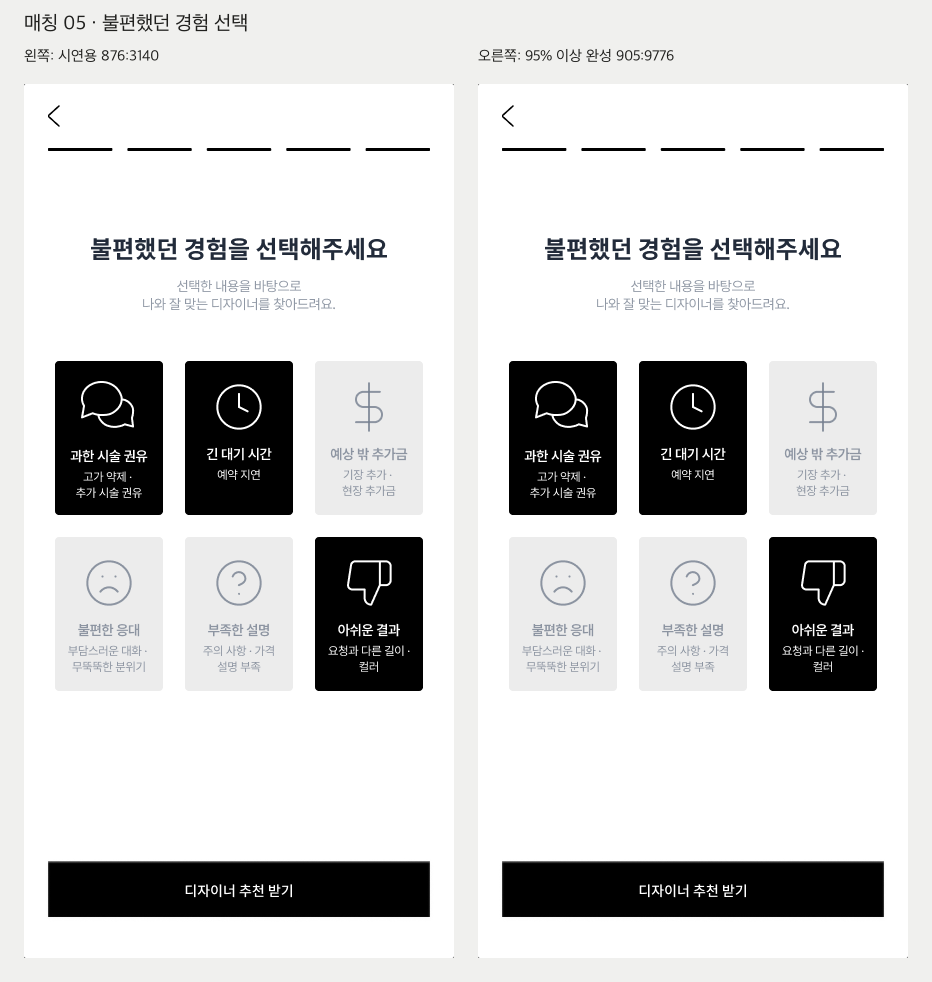
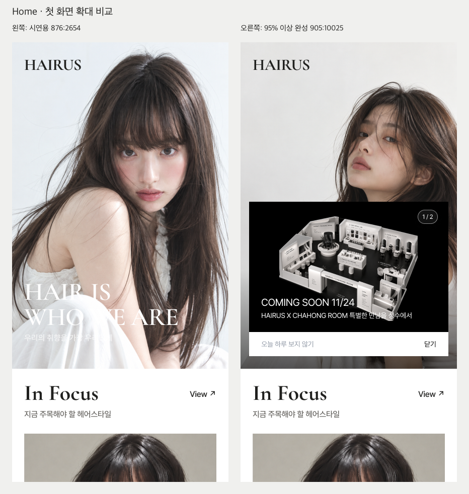
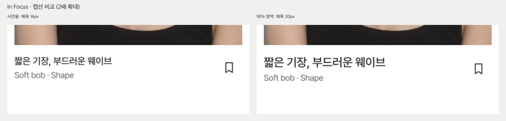

# HAIRUS — 최종 시안 선택을 위한 비교

> 2026-10-12 사용자 최종 확정: **시연용 `814:1264`의 모든 화면이 최종 디자인 기준**이다. `95% 이상 완성`은 구현 기준에서 제외한다. In Focus 캡션은 **16px**을 유지하며 Home 배너·텍스트·이미지 배치를 혼합하지 않는다. 우선순위는 시연용→시연용 공통 디자인 시스템→초안의 기능/UX→동일 시스템의 신규 화면이다. 폰트는 Cormorant Garamond, Cormorant, Pretendard만 사용하며 Noto Sans KR/Inter는 Pretendard로 대체한다. PHASE 02는 사용자 승인에 따라 진행하며 PHASE 03은 검토 후 시작한다.

2026-10-12 · 읽기 전용 재조사. Figma와 앱 코드는 변경하지 않았다. 최종 선택은 사용자에게 남긴다.

**정정:** 앞선 요약은 홈의 배너·텍스트 배치만 강조했으나, 실제로는 **히어로 사진 교체와 하단 검정 그라데이션 추가**도 있다. 이번에 image fill과 텍스트 속성을 다시 읽고 스크린샷으로 확인했다.

‘기존’은 시연용, ‘비교 시안’은 95% 이상 완성 영역을 뜻한다. 노드의 편집 시간/변경 이력을 확인한 것은 아니므로 95% 영역이 시간상 최신이라고 단정하지 않는다.

## 정확한 화면 이름과 위치

파일: `Ja8Ep1JwxOOFgMArfYr16T`, 페이지: 작업 진행 중 `693:4781`.

| 화면 역할 | 기존: 시연용 `814:1264` | 비교: 95% 이상 완성 `905:8420` | 크기 |
|---|---|---|---|
| 매칭 05 — 불편했던 경험 선택 | 원본 이름 **05**, [876:3140](https://www.figma.com/design/Ja8Ep1JwxOOFgMArfYr16T/?node-id=876-3140) | 원본 이름 **05**, [905:9776](https://www.figma.com/design/Ja8Ep1JwxOOFgMArfYr16T/?node-id=905-9776) | 각각 430×874 |
| 홈 | 원본 이름 **home**, [876:2654](https://www.figma.com/design/Ja8Ep1JwxOOFgMArfYr16T/?node-id=876-2654) | 원본 이름 **home**, [905:10025](https://www.figma.com/design/Ja8Ep1JwxOOFgMArfYr16T/?node-id=905-10025) | 각각 430×4561 |

`905:9920`도 같은 영역에 있는 home이지만, 이번 변경 비교 대상은 **905:10025**다. 두 ID를 혼동하지 않는다.

## 1. 매칭 05

사진, 텍스트, 폰트, 버튼, 6개 선택지 순서, 선택 상태, 전체 여백, 진행 표시와 CTA 구성은 비교한 속성에서 동일하다. 배너는 양쪽 모두 없다. 차이는 ‘과한 시술 권유’ 말풍선 아이콘 내부 그룹/벡터의 좌표와 크기뿐이다.

| 노드: 시연용 → 95% | 속성 | 기존(px) | 비교(px) | 변화 |
|---|---|---:|---:|---:|
| Group 12 `876:3162 → 905:9798` | width | 53.999973 | 53.999302 | −0.000671 |
| 동일 | height | 49.999229 | 49.999718 | +0.000489 |
| 동일 | x | 6.000013 | 6.000349 | +0.000336 |
| 동일 | y | 3.000385 | 3.000141 | −0.000244 |
| Vector `876:3163 → 905:9799` | x | 6.000059 | 6.000395 | +0.000336 |
| 동일 | y | 3.000385 | 3.000141 | −0.000244 |
| Vector `876:3164 → 905:9800` | x | 54.996840 | 54.997175 | +0.000335 |
| 동일 | y | 19.023138 | 19.022894 | −0.000244 |

좌표는 각 노드 부모 기준이며 전체 카드가 이동한 것이 아니다. 최대 차이가 0.001px 미만이다. 현재 추출한 510×954 PNG의 RGB 비교에서 10개 픽셀만 달랐다. 이 수치는 이번 렌더 결과에 한정되며, 모든 화면 상태의 동작 동일성을 뜻하지 않는다.

**의견:** 에디토리얼 방향과 사용성에서 의미 있는 우열은 없다. 이 미세 차이를 별도 리디자인으로 취급할 이유는 약하다. 관리상 시연용 기준을 유지하는 편이 단순하지만, 최종 선택을 적용하지 않았다. 질문 옵션 수나 선택 규칙의 개선 문제는 두 시안 간 차이와 별개다.

## 2. 홈 첫 화면

### 이미지와 배너

| 항목 | 시연용 `876:2654` | 95% 영역 `905:10025` |
|---|---|---|
| Hero 이미지 | 정면을 향한 인물, 앞머리와 긴 머리. `876:2745` | 고개를 비스듬히 든 다른 인물 사진. `905:10116` |
| 이미지 원본 hash | `b0289b1b34fe9a1c9f4e8d7069afe748e42fd487` | `52e824f89bf302c47dc355f5821ac2cc42ee4f03` |
| 이미지 박스 | 430×649, FILL, 동일 transform | 430×649, FILL, 동일 transform |
| 추가 효과 | IMAGE paint만 확인 | IMAGE 위 검정 LINEAR GRADIENT 추가: stop 약 69.692%=투명, 100%=불투명도 60% |
| 배너 | 홈 안에 POPUP 노드 없음 | `bannerPopup 905:10130` 추가, 396×307, 홈 기준 x17/y317 |
| 배너 내용 | 별도 배너 시안은 다른 위치에 존재 | 1/2, COMING SOON 11/24, 협업 안내, 오늘 하루 보지 않기, 닫기 |
| 카피와 겹침 | HAIR IS WHO WE ARE와 한국어 카피 노출 | 같은 카피 노드는 남아 있으나 배너에 가려짐. 삭제된 것이 아님 |

원본 이미지 자체가 바뀌었으므로 동일 FILL 설정이어도 인물·머리의 실루엣과 여백 인상이 달라진다. 색상 필터는 모두 기본값이며, 사진 차이를 saturation 조정만으로 설명할 수 없다.

배너는 Hero 위에 추가된 레이어다. Hero 아래 In Focus 시작 위치는 그대로다. 이미지가 배너 높이만큼 아래로 밀리는 인라인 구성은 아니다. 비교 화면에 실제로 추가된 것은 POPUP 한 장이며, ISSUE로 전환되는 작동을 스크린샷만으로 검증한 것은 아니다. 두 장 슬라이더 동작은 이미 확정한 구현 요구사항이다.

### 타이포그래피·여백·정렬

변경된 제목은 큰 영문 ‘In Focus’가 아니라 이미지 아래 **‘짧은 기장, 부드러운 웨이브’**다.

| 요소 | 시연용 | 95% 영역 | 영향 |
|---|---:|---:|---|
| 한국어 캡션 font-size | 16px | 20px | 25% 커짐, 가독성/위계 강화 |
| font-family / weight | Pretendard Medium | 동일 | 서체 교체 아님 |
| line-height / tracking | 130% / −2% | 동일 | 글자 크기 증가에 따라 실제 행 높이 증가 |
| 제목 텍스트 박스 높이 | 21px | 26px | +5px |
| Style context 높이 / y | 43px / 0.5px | 48px / 0px | 내부 정렬 변경 |
| 영문 설명 ‘Soft bob · Shape’ y | 25px | 30px | 5px 아래로 이동; 폰트는 14px Regular 그대로 |
| Caption and save 높이 | 44px | 48px | +4px |
| Save style / 44px target y | 0px | 2px | 2px 아래로 이동; 타깃 크기 그대로 |
| 이미지+캡션 카드 전체 높이 | 526px | 530px | +4px |

이 y값은 각 부모 기준이다. Home 전체의 좌우 여백, 이미지 박스, 큰 영문 제목, 후속 섹션의 위치·순서는 비교에서 바뀌지 않았다. 카드 높이만 늘었으므로 이를 ‘홈 전체 간격을 넓힌 시안’으로 해석하면 안 된다.

### 전체 콘텐츠 배치

양쪽 모두 Hero → In Focus → More to Discover → Magazine → A Seat for You → Popular Designers → Meet Your Match다. 후속 콘텐츠 순서와 사진 구성은 비교한 속성에서 동일하다. 아래 원본 전체 비교에서 긴 스크롤 구조를 확인할 수 있다.

[홈 전체 좌우 비교 PNG](comparison/home-full-side-by-side.png)

### 에디토리얼·UX 의견

- **첫 인상의 매거진 성격:** 시연용은 사진과 HAIR IS WHO WE ARE가 한 번에 읽혀 브랜드 소개에 더 적합하다. 비교 시안은 배너가 큰 면적을 차지해 첫 인상이 행사 홍보에 더 가까워진다.
- **Hero 사진:** 두 사진 모두 이미지 중심·중립 톤과 어울린다. 사진만으로 우열을 확정하기는 어렵다. 시연용은 정면 시선과 머리 질감의 밀도가 강하고, 비교 사진은 인물 포즈와 상단 여백의 인상이 다르다.
- **카피 가독성:** 시연용은 흰 의상/밝은 사진 위 흰 제목 일부의 대비가 낮다. 비교 시안의 하단 그라데이션은 밝은 글씨의 대비를 보완할 수 있지만, 현재 배너 열린 상태에서는 글씨가 가려져 이 장점이 드러나지 않는다.
- **배너 UX:** 프로모션 노출에는 비교 시안의 명시적 배너 위치가 유용하다. 다만 두 화면은 ‘배너 닫힘/열림’ 상태 차이도 포함하므로, 배너 존재만으로 전체 Home 최종안을 선택하기보다 기본 Home과 Entry Banner 열린 상태를 구분해 판단하는 편이 타당하다.
- **In Focus 가독성:** 20px 캡션은 모바일에서 주제와 영문 설명의 위계가 더 명확하다. 절제된 캡션을 선호하면 16px, 읽기 쉬운 콘텐츠 제목을 우선하면 20px 쪽에 장점이 있다. 이전 의견은 사용자 최종 결정으로 철회한다. 구현은 16px이다.

**종합 의견:** 기본 Home의 브랜드 첫인상은 시연용, In Focus 제목 가독성은 95% 시안이 더 유리하다. 배너는 별도 진입 상태로 검토하는 것이 좋다. 혼합 시안 제안은 폐기한다. 시연용 Home과 16px 캡션을 그대로 사용한다.

## 스크린샷 원본

- [매칭05 — 시연용 원본 PNG](comparison/876-3140.png)
- [매칭05 — 95% 영역 원본 PNG](comparison/905-9776.png)
- [Home — 시연용 원본 PNG](comparison/876-2654.png)
- [Home — 95% 영역 원본 PNG](comparison/905-10025.png)

원본 PNG는 Figma screenshot 반환 그대로 저장했다. 비교본은 회색 캔버스 바깥 여백 40px을 제외하고 같은 배율로 좌우 배치했으며, 상단에 한국어 식별 라벨만 추가했다. Home 첫 화면은 상단 874px 발췌, 캡션은 2배 확대다. 디자인 요소의 색·위치·크기·텍스트를 수정하지 않았다.

최종안 선택 완료: 시연용 전체. 비교 이미지는 과거 검토 기록이며 승인 요청 대상이 아니다. PHASE 02 시작 승인, Figma 수정·배포 없음.
