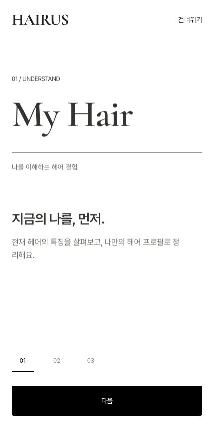
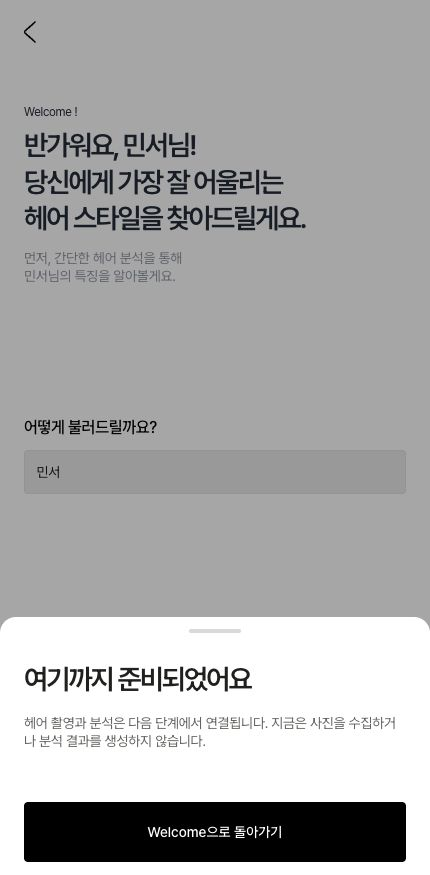

# HAIRUS — 최신 Figma 반영 및 PHASE 03 결과

2026-10-12. 기존 프로젝트·PHASE 01/02 문서·공통 컴포넌트·`/ui`를 보존하고 개발을 이어갔다. Figma 원본 수정과 배포는 하지 않았다. PHASE 04는 시작하지 않았다.

## 새 기준

`1012 코덱스 시연용 920:3429` → 기존 시연용 기록 → 공통 디자인 시스템 → 초안 UX 순서다. 95% 영역은 최종 기준으로 채택하지 않는다. 최신 섹션은 최상위 59개 항목(화면·섹션·그룹 51개, 보조 자료 8개)으로 조사했다. 전수 구조/텍스트 조사와 섹션 개요 캡처, Login/Welcome 상세 수치 확인을 구분해서 기록했다.

- Home `920:5063`, Discover `920:3479 / 3523`, 디자이너 탐색 `920:3718`, 헤어샵 탐색 `920:3855`로 구현 기준 갱신.
- Archive `920:3594`, 결과 `920:5488`, 얼굴형·기장 수정 `920:5708 / 5738`은 새 최종 화면 확보. 더 이상 전체를 임의 설계 대상으로 취급하지 않는다.
- Captured 기본/데모, 매칭 활성/비활성, Portfolio 전체/요약, Permission/이름만 같은 필터 화면을 구분했다.
- 모든 스타일·기사·배너·촬영·로딩 화면의 새 노드 ID는 [전체 변경 조사](FIGMA_1012_UPDATE.md)에 기록했다.
- In Focus 캡션은 최신 Home에서도 16px. 기존 `/ui`의 16px 유지.

## 구현

| 화면 | 기준 | URL |
|---|---|---|
| Splash | 기존 로고·시연용 디자인 시스템으로 보완 | `/` |
| 온보딩 01~03 | 사용자 선택에 따라 신규 구성 | `/onboarding/1`, `/onboarding/2`, `/onboarding/3` |
| Login | 최신 `920:5386 / 5387` | `/login` |
| Welcome | 최신 intro `920:5612`의 역할을 매핑 | `/welcome` |

온보딩 다음·이전·단계 이동·건너뛰기, 데모 로그인 안내와 진행, 이름 입력/복원, 선택적 분석 건너뛰기를 연결했다. Splash는 저장된 진행에 따라 온보딩/Login/Welcome으로 이동한다. 로그인 방식은 실제 OAuth/OTP를 실행하지 않으며 별도 시트에서 데모로 계속한다. Figma의 약관 자동 동의 문구는 실서비스로 오인하지 않도록 같은 위치에 프로토타입 고지로 대체했다. 로그인 아이콘의 제공 색상은 그대로 유지하며 HAIRUS UI에 새 색상을 도입하지 않았다.

Welcome의 민서는 예시이므로 초기 이름으로 고정하지 않는다. 사용자가 입력한 이름만 로컬에 저장한다. 건너뛰기는 분석 결과 없이 기존 Home 준비 화면으로 간다. 분석하기는 PHASE 04 미연결 안내를 표시한다. Photo Guide·Camera·AI 분석을 구현한 것으로 보고하지 않는다.

PHASE 02의 Button·BottomSheet·폰트·모바일 셸을 재사용했다. 공통 샘플과 네 탭 기반 경로는 유지했다. 로그인용 원본 SVG 3개와 뒤로가기 SVG를 추가했다. 전체 자산 다운로드 완료를 의미하지 않는다.

## 검증 결과

- `pnpm build` 통과: entry 화면 포함 13개 정적 생성 경로(Next 내부 경로 포함).
- `pnpm typecheck` 통과.
- 상태 저장 테스트 3개 통과: 손상/잘못된 값 복구, 진행/이름 보존과 분석 건너뛰기, 저장소 차단 시 예외 방지.
- 브라우저에서 온보딩1→2→3→Login→데모 안내→Welcome을 실제 조작해 확인.
- 이름 입력의 환영 문구 반영과 새로고침 복원, 분석하기 안내, 건너뛰기→Home 확인.
- 430px에서 Welcome 입력/버튼 영역382px 확인. 320px에서 온보딩·Login·Welcome·기존 `/ui` 가로 넘침 없음.
- 원본 로그인 SVG 로드, 기존 `/ui` 16px 캡션 확인. 수집된 브라우저 오류 로그 없음.
- 실제 모바일 기기·가상 키보드·화면 읽기 도구 전수 검수는 남아 있다. Figma의 광학 유리는 CSS 근사이며 픽셀 완전 동일을 주장하지 않는다.

## 문서

기존 9개 설계 문서 상단에 최신 우선순위를 추가하고 이력을 보존했다. `FIGMA_1012_UPDATE.md`에 전체 새 ID와 변경·상태 구분을 작성했다. Route Map에는 실제 구현 경로를 구분하고, Open Questions에는 온보딩 신규 구성 승인·8개 결과 필드·Archive 디자인 확보를 해결 처리했다. Asset Inventory/manifest에 원본 SVG를 추가했다.

## 남은 문제와 다음 작업

- 기존 시연용 섹션 `814:1264`와 Home `876:2654`가 현재 Figma에서 조회되지 않는다. 과거 비교는 보존된 조사 기록을 근거로 했다. 최신 섹션에 없는 디자이너 상세 등은 해당 단계에서 원본 위치 재확인이 필요하다.
- Article01 두 복제의 마지막 섹션/에필로그에24px 차이가 있다. PHASE05 전에 선택 확인. 배너 두 복제쌍은 비교 시각 속성 동일로 확인되어 재질문하지 않는다.
- 기사02~04 반복 본문, 팝업 날짜, 디자이너 필터 오복사, 살롱 인원 문구 및 누락 데이터는 후속 교정 대상이다.
- 검토 후 다음 작업은 PHASE04 촬영·분석 흐름이다. 이번에는 미착수 상태로 종료한다.

## 미리보기

현재 로컬 서버: [첫 진입](http://localhost:3000/), [온보딩부터 검토](http://localhost:3000/onboarding/1), [Login](http://localhost:3000/login), [Welcome](http://localhost:3000/welcome), [기존 UI 샘플](http://localhost:3000/ui).

서버가 종료된 경우 프로젝트 루트에서 `pnpm dev`로 다시 실행한다.

| 온보딩 신규 구성 | 최신 Welcome 구현 |
|---|---|
|  |  |
